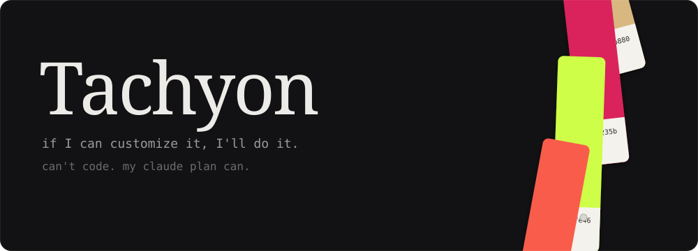
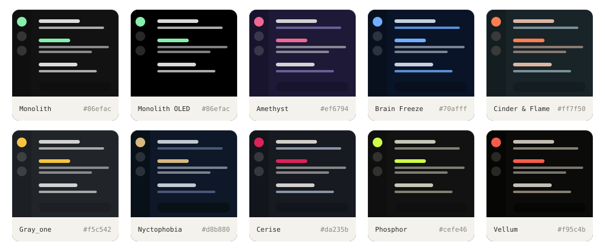
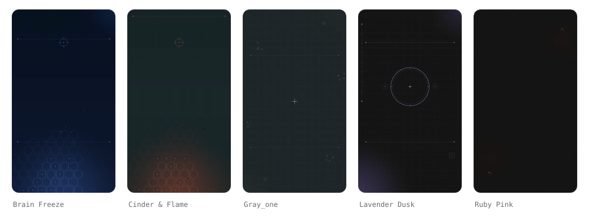
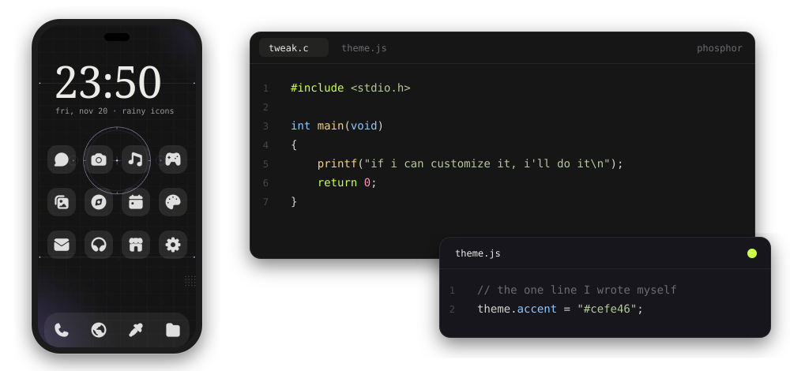

### About

<table>
	<tr>
		<td width="38%"></td>
		<td>
			<b>Hey, I'm Tachyon.</b>
			  
			I make Discord themes for Rain and Valenced, rice my Android phone, and spend an unreasonable amount of time deciding which gray a sidebar should be.
			  
			I can't really code. Claude writes it, I argue about the padding.
			  
			
			
			
			
			
		</td>
	</tr>
</table>

### Themes

Most of them come with a wallpaper:

### Projects (built to avoid the default theme)

<table>
	<tr>
		<td>
			<a href="https://github.com/Tachyon-os/Tachy_Themes"><b>Tachy_Themes</b></a>
			 
			Ten Discord themes, because the default gray felt like a personal attack.
			  
			<b>Valenced ports</b>
			 
			The same themes for another client. I moved JSON around until it stopped complaining.
			  
			<b>Rain icon pack</b>
			 
			A plumper icon set for Rain. Still in the drawing phase.
		</td>
		<td width="34%"></td>
	</tr>
</table>

### Current setup

> Every theme is finished until I open it on another monitor.
>
> I've changed the font on this page more times than I've written a for loop.
